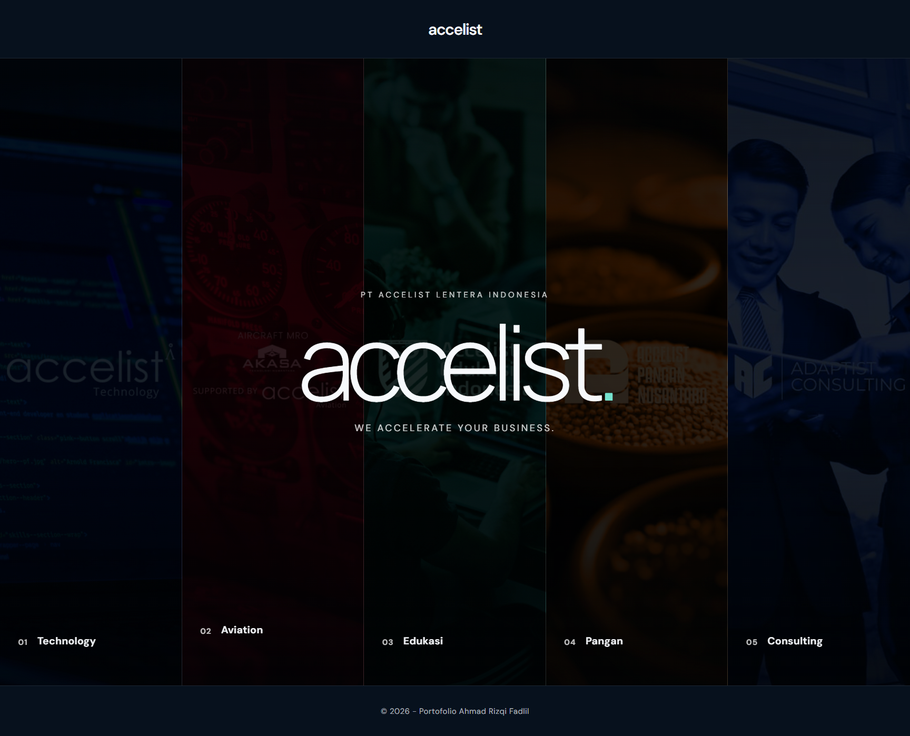

<div align="center">
  <h1>Accelist</h1>
  <p><strong>Satu ekosistem digital untuk teknologi, penerbangan, edukasi, pangan, dan konsultasi.</strong></p>
  <p>
    <a href="https://accelist.vercel.app/">Live Preview</a>
    &nbsp;·&nbsp;
    <a href="https://github.com/rizqifadil/Accelist">Source Code</a>
  </p>
  
</div>

## Tentang proyek

Landing page responsif untuk memperkenalkan lima unit bisnis Accelist. Pengunjung dapat menjelajahi setiap bidang melalui panel visual yang terhubung ke situs unit terkait.

## Fitur

- Lima panel untuk Technology, Aviation, Edukasi, Pangan, dan Consulting.
- Tampilan desktop berdampingan serta panel geser di tablet dan ponsel.
- Indikator panel interaktif di layar kecil.
- Sorotan saat panel disentuh atau difokuskan dengan keyboard.
- Navigasi keyboard dan dukungan preferensi gerakan terbatas.
- Aset gambar lokal agar foto tetap tersedia tanpa layanan gambar eksternal.

## Teknologi

`HTML` · `CSS` · `JavaScript`

## Menjalankan secara lokal

1. Clone repository ini.
2. Letakkan folder proyek di dalam `htdocs` XAMPP.
3. Buka `http://localhost/Accelist/` di browser.

Halaman ini juga dapat dibuka langsung melalui `index.html`.

## Struktur proyek

```text
Accelist/
├── assets/       # Foto panel, logo, dan screenshot
├── index.html    # Struktur halaman
├── style.css     # Gaya dan layout responsif
└── script.js     # Interaksi panel dan navigasi
```
